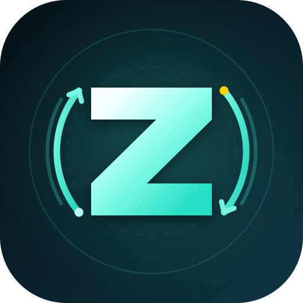

# Zync

<p align="center">
  
</p>

<p align="center">
  <strong>Nikon Z シリーズ向けの転送・ワイヤレス連携・ウォーターマークスタジオ。</strong>
</p>

<p align="center">
  <a href="README.md">English</a> |
  <a href="README.zh-CN.md">简体中文</a> |
  <a href="README.ja.md">日本語</a>
</p>

Zync は、Nikon Z シリーズでの撮影後ワークフローに焦点を当てた Flutter 製のオープンソースアプリです。カメラへの接続、写真の閲覧と転送、カラー調整、ウォーターマーク、書き出しまでを一つの流れで扱えます。Wi-Fi PTP/IP または USB PTP でカメラと直接通信し、メーカーアカウント、クラウドサービス、専用 SDK を必要としません。

- プロジェクト: <https://github.com/sa1to-asuka/Zync>
- バージョン: `1.0.0`
- ライセンス: MIT
- 主な対象プラットフォーム: Android

## 機能概要

| 分野 | Zync でできること |
| --- | --- |
| カメラ接続 | Wi-Fi PTP/IP と USB OTG PTP |
| カメラ閲覧 | JPG、NEF、NRW の閲覧と RAW 埋め込みプレビューの抽出 |
| 転送 | 分割ダウンロード、転送キュー、一時停止、取消、再試行、自動転送 |
| ウォーターマーク | 11 種類のテンプレート、EXIF、カスタム文字、ロゴ、画質設定 |
| 写真編集 | カラープリセット、露出・トーン調整、トリミング、回転、比較、コラージュ |
| レスポンシブ UI | スマートフォンでは下部ナビゲーション、大画面では左側ナビゲーション |
| アプリ更新 | GitHub Releases の確認とインストール前の SHA-256 検証 |

## 接続モード

### Wi-Fi PTP/IP

カメラが作成するアクセスポイントにスマートフォンを接続し、Zync からセッションを開始します。Command と Event に分かれた TCP チャネルを使用し、ポート、ハートビート間隔、セッション維持を設定できます。転送中のカメラ休止を減らすためのキープアライブにも対応しています。

### USB PTP

USB OTG ケーブルでカメラを接続し、カメラ側を PTP モードに設定します。Zync は Android USB Host API を使用して標準の Still Image セッションを開き、カメラの閲覧、イベント受信、ファイル転送を行います。USB 転送は Wi-Fi と共通の転送キューと書き出し履歴を使用します。

### Bluetooth LSS

Bluetooth Low Energy の LSS 経路は実験的機能で、既定では非表示です。通常の Wi-Fi または USB 転送には必要ありません。

## 主な機能

### カメラギャラリー

- カメラ内の JPG、NEF、NRW ファイルを閲覧します。
- RAW 全体をデコードする必要がない場合は、NEF/NRW 内の JPEG プレビューを抽出します。
- 1 枚ずつ、または複数選択してまとめて転送できます。
- ファイル形式、サイズ、書き出し済み状態を表示し、重複ダウンロードを減らします。
- EXIF の向きを反映し、ピンチズーム、ダブルタップズーム、下方向スワイプによる閉じる操作に対応します。
- 接続中のカメラが対応している場合、ローカルまたはカメラ側のファイルを削除できます。
- 選択した写真からコラージュを作成できます。

### 転送エンジン

- `GetPartialObject` を使用し、4 MB 単位でストリーミング転送します。
- 大きな写真や RAW の転送中も、他の画面操作を妨げません。
- 転送センターで進捗と失敗理由を確認し、一時停止、再開、個別取消、再試行、完了項目の整理ができます。
- バックグラウンド転送はフォアグラウンドサービスと進捗通知で維持され、画面ロックやアプリ切り替え後も継続できます。
- `ObjectAdded` イベントを監視し、撮影後の自動転送を任意で有効にできます。
- 書き出した写真は `/DCIM/Zync` に保存され、書き出し履歴に記録されます。

### ウォーターマークスタジオ

- ぼかし枠、ポラロイド風ペーパー、ダークグラス、雑誌風キャプション、フィルムパーフォレーション、グラデーションキャプション、ミニマルラインなど、11 種類のレイアウトを用意しています。
- 枠の比率、アクセントカラー、カード色、角丸、不透明度、書体、余白を調整できます。
- カメラ機種、レンズ、露出情報、撮影日を個別に表示または非表示にできます。
- EXIF から機種、レンズ、絞り、シャッター速度、ISO、撮影日時を自動入力します。
- 最大 2 行のカスタム文字と、ギャラリーから選択したロゴ画像を追加できます。
- JPEG 画質は 95、92、85 の 3 段階から選択できます。
- 書き出し時にサイズ、向き、機種、レンズ、露出、焦点距離、日時を EXIF に書き戻します。

### カラー調整と写真編集

- フィルム風のカラーグループとクラシックなルックを適用できます。
- 露出、コントラスト、ハイライト、シャドウ、色温度、色合い、彩度、シャープネス、ビネット、粒子を微調整できます。
- カラー調整とウォーターマークを同じ書き出し処理で組み合わせられます。
- 保存前に編集結果と元画像を比較できます。

### レスポンシブ UI と戻る操作

- ダーク、ライト、システム連動のテーマに対応します。
- スマートフォンの狭い画面では下部ナビゲーション、600 dp 以上では左側ナビゲーションに切り替わります。
- 戻る操作では、まずエディタやダイアログを閉じ、次に選択状態などを解除し、「接続」タブへ戻ります。ホームで 2 回連続して戻るとアプリを終了します。

## 使用手順

1. Nikon Z シリーズカメラの Wi-Fi を有効にするか、USB OTG ケーブルで接続します。
2. **接続**を開き、Wi-Fi PTP/IP または USB PTP セッションを確立します。
3. **カメラギャラリー**でファイルを選択し、転送キューに追加します。
4. **ウォーターマークスタジオ**でテンプレート、カラー調整、カスタム署名を適用します。
5. 完成した JPEG をスマートフォンへ書き出します。

## 互換性

- Nikon Z シリーズのミラーレスカメラを対象としています。
- Android 7.0（API 24）以降。
- Wi-Fi モードでは、スマートフォンをカメラが作成するアクセスポイントへ接続する必要があります。
- USB モードでは、スマートフォンの OTG 対応と、カメラ側の標準 PTP Still Image インターフェースおよび Bulk IN/OUT エンドポイントが必要です。
- 動作はカメラ機種、ファームウェア、ケーブル、Android の USB コントローラによって異なる場合があります。実機でのフィードバックを歓迎します。
- iOS とデスクトップ環境は十分に検証されていません。

Zync は独立したサードパーティ製プロジェクトです。Nikon との提携関係はなく、Nikon の専用 SDK も使用していません。「Nikon」「Z SERIES」などの名称は互換性を説明する目的でのみ使用しています。各商標はそれぞれの権利者に帰属します。

## 必要環境

- Dart 3.0 以降を含む Flutter SDK。プロジェクトの宣言上の最低バージョンは Flutter 3.10 です。
- Android compile SDK 36。
- JDK 17。
- ネイティブ RAW 処理モジュール用の Android NDK `28.2.13676358`。

## はじめに

```bash
git clone https://github.com/sa1to-asuka/Zync.git
cd Zync
flutter pub get
flutter run
```

## ビルド

ユニバーサル Release APK をビルドします。

```bash
flutter build apk --release
```

出力先:

```text
build/app/outputs/flutter-apk/app-release.apk
```

ARM64 のみのパッケージをデバッグシンボル分離付きでビルドします。

```bash
flutter build apk --release --split-per-abi --target-platform android-arm64 --split-debug-info=build/symbols/1.0.0-arm64
```

出力先:

```text
build/app/outputs/flutter-apk/app-arm64-v8a-release.apk
```

生成したシンボルは対応する APK と一緒に保管してください。後からクラッシュレポートをシンボル化するために必要です。通常のインストールには Debug ビルドを使用しないでください。

### Windows のビルドパス

Flutter の Release AOT ビルドは、プロジェクトパスに非 ASCII 文字が含まれる場合に失敗することがあります。`gen_snapshot` が `Unable to read file: ...app.dill` などのエラーを出した場合は、ASCII のみのパスへコピーして再ビルドしてください。

```powershell
robocopy . D:\zync_ascii /E /XD build .dart_tool .git
cd D:\zync_ascii
flutter build apk --release
```

### リリース署名

`android/key.properties` がない場合、ローカルテスト用に Debug 署名へフォールバックします。APK を配布する前にリリース用 keystore を設定してください。

```bash
keytool -genkey -v -keystore android/upload-keystore.jks -keyalg RSA -keysize 2048 -validity 10000 -alias upload
cp android/key.properties.example android/key.properties
```

`android/key.properties` に生成したパスワードとパスを記入します。このファイルと `*.jks` は Git の対象外です。

### リリース資産と更新の整合性

Zync は <https://github.com/sa1to-asuka/Zync/releases> を確認します。APK と同じ名前の SHA-256 ファイルを公開してください。

```text
Zync-release-1.0.0.apk
Zync-release-1.0.0.apk.sha256
```

チェックサムファイルの形式:

```text
<sha256>  Zync-release-1.0.0.apk
```

アプリ内アップデーターはインストール前にチェックサムを検証し、一致しない場合はインストールを中止します。

### テストと静的解析

```bash
flutter test
flutter analyze
```

## プロジェクト構成

```text
zync/
├── assets/icons/              アプリアイコン
├── android/                   Android ホスト、USB PTP、BLE、ネイティブ RAW モジュール
├── lib/
│   ├── core/                  定数、設定、テーマ、共通ユーティリティ
│   ├── protocol/              PTP/IP、USB PTP、カメラドライバー層
│   ├── engine/                転送、編集、ウォーターマーク、動画、更新ロジック
│   └── ui/                    画面、ウィジェット、レスポンシブナビゲーション
├── test/                      単体テストとウィジェットテスト
├── docs/                      プロトコル資料とリリースノート
└── pubspec.yaml
```

プロトコル層、エンジン層、UI 層は分離されています。カメラ機能はドライバーインターフェースを通じて公開されるため、UI 層へ依存させずに新しい転送方式や機種対応を追加できます。

## プロトコル参考資料

Wi-Fi と USB の転送は、公開されている Picture Transfer Protocol のモデルに従っています。

- ISO 15740 / PIMA 15740: PTP の操作、データセット、応答、USB Bulk-Only コンテナ。
- [gPhoto PTP/IP ドキュメント](http://www.gphoto.org/doc/ptpip.php): PTP/IP のパケット種別、ハンドシェイク、データフェーズの構成。
- [Android USB Host API](https://developer.android.com/guide/topics/connectivity/usb/host): USB デバイス検出、インターフェース、エンドポイント、バルク転送。
- [libgphoto2](https://github.com/gphoto/libgphoto2): PTP/IP と Nikon の操作動作に関する公開資料。

実装上の補足は `docs/protocol-sources.md` にあります。Zync のプロトコル実装には、第三者のソースコードをコピーした部分はありません。

## オープンソース謝辞

以下のプロジェクトのメンテナーとコントリビューターに感謝します。各プロジェクトの著作権とライセンスは、それぞれの作者に帰属します。

### 主要プロジェクトとプロトコル参考資料

| プロジェクト | 用途 | ライセンス |
| --- | --- | --- |
| [ImageToolbox](https://github.com/T8RIN/ImageToolbox) | 画像処理、フィルター、編集 UI の参考 | Apache-2.0 |
| [Recipe Lab](https://github.com/voxivoid/recipe-lab-sony-pmca) | カラーレシピとフィルムルックのデータ構造の参考 | GPL-3.0 |
| [SnapBridge-Enhanced](https://github.com/MXWF0/SnapBridge-Enhanced) | Nikon の接続フローと操作の参考 | 現在ライセンスファイルなし |
| [nsg](https://github.com/hurui200320/nsg) | Nikon プロトコルとデバイス機能の参考 | AGPL-3.0 |
| [libgphoto2](https://github.com/gphoto/libgphoto2) | PTP/IP と Nikon 操作コードの参考 | LGPL-2.1 |
| [ptplibrary](https://github.com/laheller/ptplibrary) | PTP/IP と USB PTP の動作参考 | 現在ライセンスファイルなし |
| [ptpip](https://github.com/mmattes/ptpip) | PTP/IP 実装の参考 | Apache-2.0 |
| [libptp](https://github.com/Fimagena/libptp) | PTP/IP と USB PTP 実装の参考 | LGPL-2.1 |
| [NikonCopy](https://github.com/Zephyrion-Yuan/NikonCopy) | Android USB OTG PTP ファイルアクセスの参考 | 現在ライセンスファイルなし |
| [furble](https://github.com/gkoh/furble) | Nikon BLE シャッター動作の参考 | MIT |
| [nikongeotag](https://github.com/rjmendez/nikongeotag) | Nikon BLE smart-device プロトコルの参考 | GPL-3.0 |

### ランタイムと基盤依存関係

| プロジェクト | 用途 | ライセンス |
| --- | --- | --- |
| [Flutter](https://github.com/flutter/flutter) | クロスプラットフォーム UI とランタイム | BSD-3-Clause |
| [Dart SDK](https://github.com/dart-lang/sdk) | Dart 言語とランタイム | BSD-3-Clause |
| [LibRaw](https://github.com/LibRaw/LibRaw) | カメラ RAW デコード | LGPL-2.1 / CDDL-1.0 |
| [AndroidX Media3](https://github.com/androidx/media) | 動画再生、フレーム抽出、編集 | Apache-2.0 |
| [Kotlin](https://github.com/JetBrains/kotlin) | Android ネイティブ言語とランタイム | Apache-2.0 |
| [flutter_svg](https://github.com/dnfield/flutter_svg) | SVG レンダリング | MIT |
| [image](https://github.com/brendan-duncan/image) | 画像エンコードと処理 | MIT |
| [exif](https://github.com/bigflood/dartexif) | EXIF メタデータの読み書き | MIT |
| [crypto](https://github.com/dart-lang/crypto) | SHA-256 とダイジェスト | BSD-3-Clause |
| [intl](https://github.com/dart-lang/i18n) | 国際化と日付書式 | BSD-3-Clause |
| [path_provider](https://github.com/flutter/packages/tree/main/packages/path_provider) | プラットフォームディレクトリの取得 | BSD-3-Clause |
| [video_player](https://github.com/flutter/packages/tree/main/packages/video_player) | 動画再生 | BSD-3-Clause |

同じ謝辞データは、アプリ内の **設定 → Zync について → プロジェクトとライセンス → オープンソース謝辞** でも確認できます。ライセンスが宣言されていないプロジェクトは、その事実を明記し、オープンソースライセンス付きとして扱いません。

## コントリビューター

- [sa1to-asuka](https://github.com/sa1to-asuka) — 作者・メンテナー
- Claude（Anthropic）— 実装・テスト・ドキュメントを支援する AI ペアプログラミングアシスタント

## ライセンス

Zync は [MIT License](LICENSE) で公開されています。Issue と Pull Request は <https://github.com/sa1to-asuka/Zync> で受け付けています。
