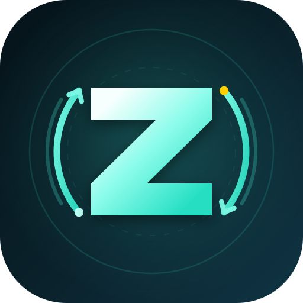

# Zync

<p align="center">
  
</p>

<p align="center">
  <strong>Nikon Z シリーズ向けの無線／USB 連携・AI 撮影／補正・物理フィルム・ウォーターマークスタジオ。</strong>
</p>

<p align="center">
  <a href="README.md">English</a> |
  <a href="README.zh-CN.md">简体中文</a> |
  <a href="README.ja.md">日本語</a>
</p>

Zync は Nikon Z シリーズ（Z 30 / Z 50II / Z fc / Z f / Z 6 / Z 8 など）の撮影から仕上げまでを一つの流れにまとめた、Flutter ＋ Kotlin/C++ 製のオープンソースフォトスタジオです。Wi-Fi PTP/IP（カメラ AP / STA モード両対応）または USB OTG PTP でカメラと直接通信し、メーカーアカウント、クラウドサービス、専用 SDK を一切必要としません。

- プロジェクト: <https://github.com/sa1to-asuka/Zync>
- バージョン: `3.0.1`
- ライセンス: MIT
- 主な対象プラットフォーム: Android（スマートフォン／タブレット 2 ペイン対応）
- 対応言語: English / 简体中文 / 日本語

## 機能概要

| 分野 | Zync でできること |
| --- | --- |
| カメラ接続 | Wi-Fi PTP/IP（AP＋STA）、USB OTG PTP、BLE GPS `0x2007` 位置情報注入 |
| AI 構図コーチ 2.0 | BYOK ビジョン／推論モデルが雑然とした画面から最適なトリミング範囲と縦横比を発見し、光線・構図・タイミングの助言、ワンタップ AF、露出/`.NP3` 同期を実行 |
| 撮影台（ライブビュー） | ライブビュー、リモートシャッター、露出スライダー、タップ／マニュアルフォーカス、インターバル撮影、ブラケット撮影、カメラ内 HDR、録画制御、ピーキング、ゼブラ、ヒストグラム |
| ギャラリー＆転送 | 撮影日時順の統合カード表示（JPG/NEF/NRW）、512 KB レジューム転送、`0x9431` 4 GiB 超動画転送、撮影同時転送、フォアグラウンド維持、コマ別ズーム＆パン対応コラージュ |
| AI スマート補正 2.0 | 縮小プレビューと Zync 内蔵フィルター・SpektraFilm・プリセット一覧を AI に送り、最適な 3 案と微調整パラメーターを提案。長押し比較や自然言語微調整に対応 |
| ウォーターマーク | 16 種類のテンプレート、詳細パラメータ編集、自由配置アートテキスト・SVG ロゴ、クラウド商用可中国語フォント、コンパクトプリセット帯、SpektraFilm 20 種物理フィルム |
| ピクチャーコントロール | PTP/IP 経由で C1–C9 スロットの `.NP3`/`.NCP` を読み書き（Flexible Color 0310 変換対応）、257 点トーンカーブ確認 |
| 動画エディター | マルチクリップタイムライン、`.cube` 3D LUT、キーフレーム、ウェーブフォーム／ベクトルスコープ／ヒストグラム、1080p/4K 書き出し |
| 導入＆セキュリティ | API キー設定ガイド含む 4 ステップオンボーディング、Android Keystore（AES-256-GCM）暗号化保存、AP 接続時のモバイル回線バイパス、SHA-256 更新検証 |

## AI エンジン（BYOK）

Zync 3.0.1 は **OpenAI 互換** と **Anthropic 互換** の双方に対応し、ご自身の API キーを登録して利用できます。

- **クイックプリセット**: DeepSeek 公式、Alibaba Bailian (Qwen-VL)、Zhipu (GLM-4V)、SiliconFlow、Volcengine Ark、Google Gemini、OpenAI 公式、Anthropic Claude、OpenRouter、ローカル Ollama。
- **カメラ AP 接続時のモバイル回線バイパス**: カメラの Wi-Fi AP に接続中も Android `CellularHttpBridge` で AI リクエストのみ 4G/5G 経由で送信し、カメラ接続を維持します。
- **テキスト専用モデル橋渡し＆JSON 自動修復**: テキスト専用モデル（`deepseek-chat` / `deepseek-reasoner` 等）が画像入力を拒否した場合、ローカルで 3×3 空間輝度・色・Sobel エッジ計測値へ自動変換して推論を続行し、途切れた JSON や `<think>` ブロックも安全に復旧します。

## 接続モード

### Wi-Fi PTP/IP

カメラが作成するアクセスポイントにスマートフォンを接続し、Zync からセッションを開始します。Command と Event に分かれた TCP チャネルを使用し、ポート、ハートビート間隔、セッション維持を設定できます。転送中のカメラ休止を減らすためのキープアライブにも対応しています。

### USB PTP

USB OTG ケーブルでカメラを接続し、カメラ側を PTP モードに設定します。Zync は Android USB Host API を使用して標準の Still Image セッションを開き、カメラの閲覧、イベント受信、ファイル転送を行います。USB 転送は Wi-Fi と共通の転送キューと書き出し履歴を使用します。

### Bluetooth LSS

Bluetooth Low Energy の LSS 経路は実験的機能で、既定では非表示です。通常の Wi-Fi または USB 転送には必要ありません。

## 主な機能

### 撮影台（ライブビュー）

- Wi-Fi PTP/IP または USB PTP でカメラのライブビューを取得し、スマートフォンからシャッターを切れます。
- 露出モード、絞り、シャッター速度、ISO、露出補正を読み書きします。書き込み後は必ず読み戻して比較するため、カメラが黙って無視した変更を「成功」として表示しません。
- 画面をタップしてフォーカスポイントを移動するか、フォーカスボタンで中央に合わせます。
- 撮影の成否はカメラのオブジェクト一覧に新しいハンドルが現れたかで判定し、シャッターの応答コードでは判定しません。タイムアウトは「完了していない可能性」として提示し、自動再試行は行いません。
- 撮影した写真は既存の「撮影と同時に転送」スイッチで自動的に転送キューへ入れられます。
- 絞り・シャッター速度・ISO・露出補正はスライダーで調整します。ドラッグ中は値のプレビューのみで、指を離したときに一度だけカメラへ書き込みます。
- 現在の露出モードで変更できる項目だけが操作可能です。A モードではシャッター速度と ISO がグレー表示になり、理由も表示します。
- フォーカスピーキング、ゼブラ、輝度ヒストグラム、構図グリッド、ガイド線は端末側でプレビューから計算され、書き出した写真には影響しません。
- マニュアルフォーカスの矢印を押し続けるとピントを移動でき、AF ボタンで実際のオートフォーカスを実行します。
- インターバル撮影：間隔・枚数・開始までの待ち時間を決めて自動撮影します。撮影後の自動転送もそのまま使えます。
- カメラ内 HDR：本体が2枚撮って1枚の JPEG に合成します（`0xD130`–`0xD133`）。元画像をカードに残すこともできます。
- ブラケット／フォーカススタッキングの後、アプリ内で1枚に合成できます。元画像は常にカメラのカードに残り、合成画像は共有向け解像度で指定フォルダーに保存されます。
- 静止画／動画モードの切り替えとアプリからの録画開始・停止。REC タイマーとステレオ音声レベルを表示し、本体の赤い録画ボタンで操作した場合もライブビューヘッダの録画フラグで同期します。
- 露出ブラケット：EV／シャッター／ISO の3軸から選び、枚数とステップを指定。正常終了・途中停止・書き込み拒否のいずれでも元の値に戻します。
- フォーカスブラケット：一定ステップでフォーカスを送りながら連写し、完了後に起点へ戻すこともできます。
- スマートフォンではホームのグリッドから全画面で開くツール、タブレットではサイドパネル付きの 2 ペイン作業画面になります。ライブビューとリモート撮影は Nikon Z 30 で検証済みです。他の機種では動作が異なる場合があり、画面にもその旨を表示します。

### カメラギャラリー

- カメラ内の JPG、NEF、NRW ファイルを閲覧します。
- RAW 全体をデコードする必要がない場合は、NEF/NRW 内の JPEG プレビューを抽出します。
- 1 枚ずつ、または複数選択してまとめて転送できます。
- ファイル形式、サイズ、書き出し済み状態を表示し、重複ダウンロードを減らします。
- EXIF の向きを反映し、ピンチズーム、ダブルタップズーム、下方向スワイプによる閉じる操作に対応します。
- 接続中のカメラが対応している場合、ローカルまたはカメラ側のファイルを削除できます。
- 選択した写真からコラージュを作成できます。

### 転送エンジン

- `GetPartialObject` を使用し、512 KB 単位でストリーミング転送します。
- 転送キューはディスクに保存され、アプリ終了や再接続の後も続きのバイトから再開します。カメラ側の ObjectHandle はファイル名・サイズ・撮影日時で再照合し、一致しない場合は推測せずに通知します。
- 4 GiB を超えるファイルは `0x9431 GetPartialObject64` に切り替え、長い動画が 32 ビット境界で切れないようにします。
- Wi-Fi 切断や USB 抜去ではキューを失敗扱いにせず「再接続待ち」にし、再接続後に自動で再開します。
- 大きな写真や RAW の転送中も、他の画面操作を妨げません。
- 転送センターで進捗と失敗理由を確認し、一時停止、再開、個別取消、再試行、完了項目の整理ができます。
- バックグラウンド転送はフォアグラウンドサービスと進捗通知で維持され、画面ロックやアプリ切り替え後も継続できます。
- `ObjectAdded` イベントを監視し、撮影後の自動転送を任意で有効にできます。
- 書き出した写真は `/DCIM/Zync` に保存され、書き出し履歴に記録されます。

### ウォーターマークスタジオ

- ぼかし枠、ポラロイド風ペーパー、ダークグラス、雑誌風キャプション、フィルムパーフォレーション、グラデーションキャプション、ミニマルラインなど、16 種類のレイアウトを用意しています。
- 枠の比率、アクセントカラー、カード色、角丸、不透明度、書体、余白を調整できます。
- カメラ機種、レンズ、露出情報、撮影日を個別に表示または非表示にできます。
- EXIF から機種、レンズ、絞り、シャッター速度、ISO、撮影日時を自動入力します。
- 最大 2 行のカスタム文字を追加できます。
- JPEG 画質は 95、92、85 の 3 段階から選択できます。
- 書き出し時にサイズ、向き、機種、レンズ、露出、焦点距離、日時を EXIF に書き戻します。
- 「フィルムプリセット」と「パラメーター調整」を統合した**プリセット調整**パネル：上部プリセットストリップ、折りたたみ式のパラメーターグループ、250ms のスムーズなプリセット遷移、自作プリセットの保存・名前変更・上書き・削除に対応。
- **フィルムシミュレーション**は [spektrafilm](https://github.com/andreavolpato/spektrafilm) の物理エンジンを独立ネイティブ移植：20 種類の実フィルム、8 種類の印画紙、ネガ直接スキャン、実測 H&D 濃度曲線、DIR カプラー、ハレーション、銀塩粒子、引き伸ばし機のフィルターバランスに対応。

### ピクチャーコントロール

- PTP/IP（`0x90CC` / `0x90CD`）経由でカメラ内カスタムピクチャーコントロールを読み書きし、C1–C9 スロットへ書き込んで読み戻し検証します。
- NP3/NCP レシピのローカルライブラリを管理し、ファイルマネージャー、WeChat、QQ からの読み込み、名前変更、共有、削除に対応します。
- 1 スロットへの書き込み、または複数レシピの C1–C9 への一括割り当て書き込みに対応します。
- 保存済みスロットをカメラの現在のピクチャーコントロール（`0xD200`）として有効化し、カメラ側スロットをスマートフォンへバックアップできます。
- Flexible Color（0310）レシピを解析し、標準 NP3 へ変換してから書き込めます。
- 内蔵サンプルシーンでレシピをプレビューし、左右ドラッグ比較、257 点トーンカーブ、全パラメーター調整に対応します。

### 動画エディター

- 複数クリップのタイムラインでトリム、並べ替え、連結、チャプターマーカーに対応します。
- 露出、階調、カラーホイール、キーフレームによるグレーディングと `.cube` LUT。
- ウェーブフォーム、ベクトルスコープ、RGB パレード、ヒストグラムのスコープ表示。
- 1080p / 4K を H.264 または HEVC で書き出し。HDR 入力は SDR にトーンマップします。

### カラー調整と写真編集

- フィルム風のカラーグループとクラシックなルックを適用できます。
- 露出、コントラスト、ハイライト、シャドウ、色温度、色合い、彩度、シャープネス、ビネット、粒子を微調整できます。
- カラー調整とウォーターマークを同じ書き出し処理で組み合わせられます。
- 保存前に編集結果と元画像を比較できます。

### レスポンシブ UI と戻る操作

- ダーク、ライト、システム連動のテーマに対応します。
- スマートフォンの狭い画面では下部ナビゲーション、600 dp 以上では左側ナビゲーションに切り替わります。
- 戻る操作では、まずエディタやダイアログを閉じ、次に選択状態などを解除し、「接続」タブへ戻ります。ホームで 2 回連続して戻るとアプリを終了します。

## 使用手順

1. Nikon Z シリーズカメラの Wi-Fi を有効にするか、USB OTG ケーブルで接続します。
2. **接続**を開き、Wi-Fi PTP/IP または USB PTP セッションを確立します。
3. **カメラギャラリー**でファイルを選択し、転送キューに追加します。
4. **ウォーターマークスタジオ**でテンプレート、カラー調整、カスタム署名を適用します。
5. 完成した JPEG をスマートフォンへ書き出します。

## 互換性

- Nikon Z シリーズのミラーレスカメラを対象としています。
- Android 7.0（API 24）以降。
- Wi-Fi モードでは、スマートフォンをカメラが作成するアクセスポイントへ接続する必要があります。
- USB モードでは、スマートフォンの OTG 対応と、カメラ側の標準 PTP Still Image インターフェースおよび Bulk IN/OUT エンドポイントが必要です。
- 動作はカメラ機種、ファームウェア、ケーブル、Android の USB コントローラによって異なる場合があります。実機でのフィードバックを歓迎します。
- iOS とデスクトップ環境は十分に検証されていません。

Zync は独立したサードパーティ製プロジェクトです。Nikon との提携関係はなく、Nikon の専用 SDK も使用していません。「Nikon」「Z SERIES」などの名称は互換性を説明する目的でのみ使用しています。各商標はそれぞれの権利者に帰属します。

## 必要環境

- Dart 3.0 以降を含む Flutter SDK。プロジェクトの宣言上の最低バージョンは Flutter 3.10 です。
- Android compile SDK 36。
- JDK 17。
- ネイティブ RAW 処理モジュール用の Android NDK `28.2.13676358`。

## はじめに

```bash
git clone https://github.com/sa1to-asuka/Zync.git
cd Zync
flutter pub get
flutter run
```

## ビルド

スマートフォンには容量の小さい ABI 分割版（`arm64-v8a` 約 49 MB）を推奨します。`x86_64` を除いたデュアル ARM 版（約 75 MB）もビルド可能です。

```bash
flutter build apk --release --split-per-abi
flutter build apk --release --target-platform android-arm64,android-arm
```

出力先:

```text
build/app/outputs/flutter-apk/app-arm64-v8a-release.apk
build/app/outputs/flutter-apk/app-release.apk
```

### Windows のビルドパス

プロジェクトパスに非 ASCII 文字が含まれる場合、`subst` で ASCII ドライブ文字を割り当ててからビルドしてください。

```powershell
subst S: "D:\your-non-ascii-path\Nikon-SnapLink"
cd S:\Zync
flutter build apk --release --split-per-abi
```

### リリース署名

`android/key.properties` がない場合、ローカルテスト用に Debug 署名へフォールバックします。APK を配布する前にリリース用 keystore を設定してください。

```bash
keytool -genkey -v -keystore android/upload-keystore.jks -keyalg RSA -keysize 2048 -validity 10000 -alias upload
cp android/key.properties.example android/key.properties
```

`android/key.properties` に生成したパスワードとパスを記入します。このファイルと `*.jks` は Git の対象外です。

### インストールできない場合

公開パッケージは `Zync-release-<ver>-arm64-v8a.apk`（64 ビット端末推奨）、`Zync-release-<ver>.apk`（ARM 汎用版）、`Zync-release-<ver>-armeabi-v7a.apk`（旧 32 ビット端末）です。

Android がインストールを拒否する場合:

1. 異なる署名鍵でビルドされた古い Zync が残っている場合は先にアンインストールしてください。
2. 使用するブラウザやファイルマネージャーに「不明なアプリのインストール」を許可してください。
3. 端末の CPU アーキテクチャに合った ABI パッケージを選択してください。

### リリース資産と更新の整合性

Zync は <https://github.com/sa1to-asuka/Zync/releases> を確認します。APK と SHA-256 ファイルを公開してください。

```text
Zync-release-3.0.1.apk
Zync-release-3.0.1-arm64-v8a.apk
Zync-release-3.0.1.apk.sha256
```

チェックサムファイルの形式:

```text
<sha256>  Zync-release-3.0.1.apk
```

アプリ内アップデーターはインストール前にチェックサムを検証し、一致しない場合はインストールを中止します。

### テストと静的解析

```bash
flutter test
flutter analyze
```

## プロジェクト構成

```text
zync/
├── assets/icons/              アプリアイコン
├── android/                   Android ホスト、USB PTP、BLE、ネイティブ RAW モジュール
├── lib/
│   ├── core/                  定数、設定、テーマ、共通ユーティリティ
│   ├── protocol/              PTP/IP、USB PTP、カメラドライバー層
│   ├── engine/                転送、編集、ウォーターマーク、動画、更新ロジック
│   └── ui/                    画面、ウィジェット、レスポンシブナビゲーション
├── test/                      単体テストとウィジェットテスト
├── docs/                      プロトコル資料とリリースノート
└── pubspec.yaml
```

プロトコル層、エンジン層、UI 層は分離されています。カメラ機能はドライバーインターフェースを通じて公開されるため、UI 層へ依存させずに新しい転送方式や機種対応を追加できます。

## プロトコル参考資料

Wi-Fi と USB の転送は、公開されている Picture Transfer Protocol のモデルに従っています。

- ISO 15740 / PIMA 15740: PTP の操作、データセット、応答、USB Bulk-Only コンテナ。
- [gPhoto PTP/IP ドキュメント](http://www.gphoto.org/doc/ptpip.php): PTP/IP のパケット種別、ハンドシェイク、データフェーズの構成。
- [Android USB Host API](https://developer.android.com/guide/topics/connectivity/usb/host): USB デバイス検出、インターフェース、エンドポイント、バルク転送。
- [libgphoto2](https://github.com/gphoto/libgphoto2): PTP/IP と Nikon の操作動作に関する公開資料。

実装上の補足は `docs/protocol-sources.md` にあります。Zync のプロトコル実装には、第三者のソースコードをコピーした部分はありません。

## オープンソース謝辞

以下のプロジェクトのメンテナーとコントリビューターに感謝します。各プロジェクトの著作権とライセンスは、それぞれの作者に帰属します。

### 主要プロジェクトとプロトコル参考資料

| プロジェクト | 用途 | ライセンス |
| --- | --- | --- |
| [ImageToolbox](https://github.com/T8RIN/ImageToolbox) | 画像処理、フィルター、編集 UI の参考 | Apache-2.0 |
| [Recipe Lab](https://github.com/voxivoid/recipe-lab-sony-pmca) | カラーレシピとフィルムルックのデータ構造の参考 | GPL-3.0 |
| [Spektrafilm](https://github.com/andreavolpato/spektrafilm) | 独立ネイティブ分光フィルムエンジン：H&D 濃度曲線、DIR カプラー、ハレーション、銀塩粒子、印画紙処理 | コード GPL-3.0 / プロファイル CC BY-SA 4.0 |
| [NICO](https://github.com/haecksenwerk/nico) | USB ライブビュー、フォーカスポイント選択、露出プロパティ読み書きの参考 | MIT |
| [OpenCine](https://github.com/erik-sutton95/OpenCine) | Zシリーズの世代別ケイパビリティ、PTP/IP `0x000D` 生存確認、`0x9431` 分割転送、ライブビューヘッダ解析の参考 | Apache-2.0 |
| [OpenZCine](https://github.com/erik-sutton95/OpenZCine) | 再接続ステートマシン（試行タイムアウト、復旧予算、バックオフ、再接続ストーム抑制）の参考 | Apache-2.0 |
| [digiCamControl](https://github.com/dukus/digiCamControl) | ブラケット撮影の系列生成・パラメータ復元、A-B フォーカススタッキング操作の参考 | MIT |
| [airnef](https://github.com/besi/airnef) | レジューム転送の検証方針の参考。ソースコードは流用していません | GPL-3.0 |
| [Shotdeck](https://github.com/Fluoro-Antimonic-Acid/Shotdeck) | ライブビュー・撮影・オブジェクト確定動作の参考 | GPL-3.0 |
| [LutCameraPro](https://github.com/laodamanbaout/LutCameraPro-) | PTP/IP ライブビューと接続境界の参考 | Apache-2.0 |
| [1dlut-z30-filters](https://github.com/haotiandi1011-lgtm/1dlut-z30-filters) | Z 30 トーンカーブ構造、121 種のコミュニティ/階調レシピおよび C1–C9 書込検証の参考 | MIT |
| [aero-shutter](https://github.com/subhashraveendran/aero-shutter) | Wi-Fi PTP/IP 取り込み動作の参考 | MIT |
| [NikonCameraControl](https://github.com/youdangshi/NikonCameraControl) | Android リモート操作と転送フローの参考 | MIT |
| [SnapBridge-Enhanced](https://github.com/MXWF0/SnapBridge-Enhanced) | Nikon の接続フローと操作の参考 | 現在ライセンスファイルなし |
| [nsg](https://github.com/hurui200320/nsg) | Nikon プロトコルとデバイス機能の参考 | AGPL-3.0 |
| [libgphoto2](https://github.com/gphoto/libgphoto2) | PTP/IP と Nikon 操作コードの参考 | LGPL-2.1 |
| [ptplibrary](https://github.com/laheller/ptplibrary) | PTP/IP と USB PTP の動作参考 | 現在ライセンスファイルなし |
| [ptpip](https://github.com/mmattes/ptpip) | PTP/IP 実装の参考 | Apache-2.0 |
| [libptp](https://github.com/Fimagena/libptp) | PTP/IP と USB PTP 実装の参考 | LGPL-2.1 |
| [NikonCopy](https://github.com/Zephyrion-Yuan/NikonCopy) | Android USB OTG PTP ファイルアクセスの参考 | 現在ライセンスファイルなし |
| [furble](https://github.com/gkoh/furble) | Nikon BLE シャッター動作と `0x2007` 位置情報同期の参考 | MIT |
| [nikongeotag](https://github.com/rjmendez/nikongeotag) | Nikon BLE smart-device プロトコルの参考 | GPL-3.0 |
| [semi-utils](https://github.com/leslievan/semi-utils) | カメラ EXIF ウォーターマークテンプレート設計のリファレンス | Apache-2.0 |
| [Copicseal](https://github.com/copicseal/copicseal) | パラメータ帯・枠なし・レトロ日付スタンプレイアウトのリファレンス | Apache-2.0 |
| [PicSeal](https://github.com/pipiqiang/PicSeal) | カメラ機種自動判定・ブランド風生成・EXIF 保持のリファレンス | MIT |
| [camera-watermark](https://github.com/myWsq/camera-watermark) | ミラーレス/一眼 EXIF ウォーターマークおよび項目カスタマイズ UI の参考 | MIT |
| [zf-capture-one-helper](https://github.com/open-nikonz/zf-capture-one-helper) | Nikon Z `_ptp._tcp` Bonjour フィールドと STA ペアリング手順の参考 | Apache-2.0 |
| [openai-openapi](https://github.com/openai/openai-openapi) | Zync BYOK AI 撮影支援・スマート補正用 OpenAI 互換マルチモーダル視覚 API 仕様の参考 | MIT |
| [anthropic-sdk-python](https://github.com/anthropics/anthropic-sdk-python) | Zync BYOK AI 撮影支援・スマート補正用 Anthropic Messages API プロトコルの参考 | Apache-2.0 |
| [Google Fonts · English Artistic Fonts](https://github.com/google/fonts) | Playfair Display / Cinzel / Caveat / JetBrains Mono 内蔵欧文フォント | SIL OFL-1.1 |
| [LXGW WenKai / Zhuque Fangsong / ZCOOL](https://github.com/lxgw/LxgwWenKai) | クラウドオンデマンド中国語アートフォント群 | SIL OFL-1.1 |

### ピクチャーコントロールのレシピとプレビュー素材

| プロジェクト | 用途 | ライセンス |
| --- | --- | --- |
| [Z30-Recipes](https://github.com/yekong-nasa/Z30-Recipes) | Nikon Z30 PTP/IP（0x90CC/0x90CD/0xD200）カメラ内ピクチャーコントロールの読み書きと NP3/NCP 解析の参考 | MIT |
| [NikonNP3](https://github.com/Timor88/NikonNP3) | Nikon NP3 クリエイティブカラーレシピ集とカテゴリの参考 | コミュニティ共有 |
| [nikon-flexible-color-picture-control](https://github.com/ssssota/nikon-flexible-color-picture-control) | Nikon Flexible Color NP3（0310）のバイナリオフセットとカラーミキサー構造の参考 | MIT |
| [Nikon Imaging（ニコンイメージング）](https://www.nikon-image.com/) | ピクチャーコントロール近似プレビュー用の公式サンプル写真（Z 30 / Z fc / Z f / Z 8） | Nikon 公式サンプル展示条件 |
| [Pakutaso（ぱくたそ）](https://www.pakutaso.com/) | ピクチャーコントロール近似プレビュー用クラウドサンプル素材（人物・街並み・桜・自然・海・星空・夕日） | Pakutaso 無料素材条件 |
| [影视飓风（YSJF）](https://www.ysjf.com/index) | ピクチャーコントロール近似プレビュー用の風景・自然サンプル素材の謝辞 | 無料サンプル素材条件 |

### ランタイムと基盤依存関係

| プロジェクト | 用途 | ライセンス |
| --- | --- | --- |
| [Flutter](https://github.com/flutter/flutter) | クロスプラットフォーム UI とランタイム | BSD-3-Clause |
| [Dart SDK](https://github.com/dart-lang/sdk) | Dart 言語とランタイム | BSD-3-Clause |
| [LibRaw](https://github.com/LibRaw/LibRaw) | カメラ RAW デコード | LGPL-2.1 / CDDL-1.0 |
| [AndroidX Media3](https://github.com/androidx/media) | 動画再生、フレーム抽出、編集 | Apache-2.0 |
| [Kotlin](https://github.com/JetBrains/kotlin) | Android ネイティブ言語とランタイム | Apache-2.0 |
| [flutter_svg](https://github.com/dnfield/flutter_svg) | SVG レンダリング | MIT |
| [image](https://github.com/brendan-duncan/image) | 画像エンコードと処理 | MIT |
| [exif](https://github.com/bigflood/dartexif) | EXIF メタデータの読み書き | MIT |
| [crypto](https://github.com/dart-lang/crypto) | SHA-256 とダイジェスト | BSD-3-Clause |
| [intl](https://github.com/dart-lang/i18n) | 国際化と日付書式 | BSD-3-Clause |
| [path_provider](https://github.com/flutter/packages/tree/main/packages/path_provider) | プラットフォームディレクトリの取得 | BSD-3-Clause |
| [video_player](https://github.com/flutter/packages/tree/main/packages/video_player) | 動画再生 | BSD-3-Clause |
| [archive](https://github.com/brendan-duncan/archive) | NP3/NCP レシピパックおよびフォントアーカイブの ZIP 解凍処理 | MIT |
| [flutter_localizations](https://github.com/flutter/flutter/tree/master/packages/flutter_localizations) | 多言語ローカライズ委譲とリソース読み込み | BSD-3-Clause |
| [animations](https://github.com/flutter/packages/tree/main/packages/animations) | Material トランジション（FadeThrough / SharedAxis） | BSD-3-Clause |

同じ謝辞データは、アプリ内の **設定 → Zync について → プロジェクトとライセンス → オープンソース謝辞** でも確認できます。ライセンスが宣言されていないプロジェクトは、その事実を明記し、オープンソースライセンス付きとして扱いません。

## コントリビューター

- [sa1to-asuka](https://github.com/sa1to-asuka) — 作者・メンテナー
- Claude（Anthropic）— 実装・テスト・ドキュメントを支援する AI ペアプログラミングアシスタント

## ライセンス

Zync は [MIT License](LICENSE) で公開されています。Issue と Pull Request は <https://github.com/sa1to-asuka/Zync> で受け付けています。
