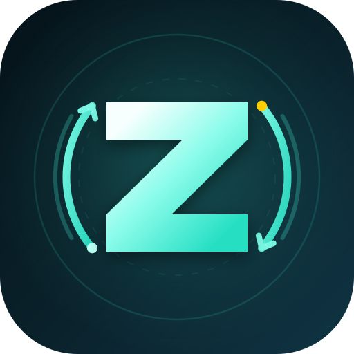

# Zync

<p align="center">
  
</p>

<p align="center">
  <strong>Nikon Z-series wireless/USB tethering, AI framing &amp; grading, spectral film, and watermark studio.</strong>
</p>

<p align="center">
  <a href="README.md">English</a> |
  <a href="README.zh-CN.md">简体中文</a> |
  <a href="README.ja.md">日本語</a>
</p>

Zync is an open-source Flutter and Kotlin/C++ photography studio built for Nikon Z-series mirrorless cameras (Z 30, Z 50II, Z fc, Z f, Z 6, Z 8, etc.): connect directly over Wi-Fi PTP/IP (both camera AP and LAN STA modes) or USB OTG PTP without any vendor account, cloud service, or proprietary SDK. It spans live view remote capture, AI Composition Coach, camera gallery browsing with resumable chunked transfers, in-camera `.NP3` Picture Control slots, 16-bit RAW & SpektraFilm optical processing, AI Smart Color Grading, free-drag watermark layers, and pan/zoom photo collages.

- Project: <https://github.com/sa1to-asuka/Zync>
- Version: `3.0.1`
- License: MIT
- Primary platform: Android (adaptive phone & tablet split-pane UI)
- Languages: English / 简体中文 / 日本語

## Highlights

| Area | What Zync provides |
| --- | --- |
| Camera connection | Wi-Fi PTP/IP (AP + STA modes), USB OTG PTP, and BLE GPS `0x2007` coordinate sync |
| AI Live-View Coach 2.0 | BYOK vision/reasoning models highlight the best cropped composition (`portrait`/`landscape`) inside cluttered scenes, offer actionable lighting/timing tips, one-tap AF on subject, and exposure/`.NP3` sync |
| Capture | Live view, remote shutter, exposure sliders, tap-to-focus, manual focus, interval shooting, focus bracketing, exposure bracketing, HDR, recording control, peaking, zebra & histogram |
| Gallery & Transfer | Date-sorted unified storage card view for JPG/NEF/NRW, 512 KB resumable partial downloads, `0x9431` 4 GiB+ video support, Shoot & Transfer, foreground service, and pan/zoom collage studio |
| AI Smart Color Grading 2.0 | Sends a fast downscaled preview and Zync's built-in filter, SpektraFilm & preset catalog to AI for top 3 curated recipes with per-photo fine-tuning, hold-to-compare, and natural-language refinement |
| Watermark studio | 16 templates, EXIF editing pill, free-drag artistic text & SVG logo layers, cloud Chinese artistic fonts, compact preset strip, and 20 SpektraFilm optical film profiles |
| Picture Control studio | Read/write custom `.NP3`/`.NCP` slots C1–C9 over PTP/IP, Flexible Color (`0310`) conversion, and 257-point tone curve previews |
| Video editor | Multi-clip timeline, `.cube` 3D LUT grading, keyframes, waveform/vectorscope/RGB parade/histogram, and 1080p/4K export |
| Security & Onboarding | 4-step onboarding including API Key setup tutorial, Android Keystore (AES-256-GCM) key vault, cellular bypass in camera AP, and SHA-256 release verification |

## AI Engine (BYOK)

Zync 3.0.1 supports both **OpenAI-compatible** and **Anthropic-compatible** endpoints with user-supplied API keys:

- **Quick provider templates**: DeepSeek Official, Alibaba Bailian (Qwen-VL), Zhipu (GLM-4V), SiliconFlow, Volcengine Ark, Google Gemini, OpenAI Official, Anthropic Claude, OpenRouter, and local Ollama.
- **Cellular Bypass on Camera AP**: Android `CellularHttpBridge` routes single AI HTTP calls over mobile data when the phone is joined to a camera's offline Wi-Fi hotspot without breaking PTP/IP.
- **Text-Only Model Bridge & JSON Auto-Repair**: Automatically computes a 3×3 spatial luminance/RGB/saturation/Sobel-edge telemetry summary when text-only endpoints (such as `deepseek-chat` / `deepseek-reasoner`) reject raw `image_url` blocks, and repairs truncated JSON / unclosed `<think>` reasoning blocks.
- **Hardware Key Isolation**: Keys are stored exclusively in Android Keystore AES-256-GCM prefs and masked in all UI displays and diagnostics.

## Connection modes

### Wi-Fi PTP/IP

Join the access point created by the camera, then connect from Zync. The Wi-Fi transport uses separate command and event TCP channels, configurable port and heartbeat settings, and a keep-alive path intended to prevent the camera from sleeping during a session.

### USB PTP

Connect the camera with a USB OTG cable and select the camera's PTP mode. Zync uses the Android USB Host API to open a standard Still Image session, browse the camera, receive events, and download files. USB transfers use the same queue and export history as Wi-Fi transfers.

### Bluetooth LSS

The Bluetooth Low Energy LSS path is experimental and hidden by default. It is not required for normal Wi-Fi or USB transfer.

## Features

### Capture (live view)

- Stream the camera live view over Wi-Fi PTP/IP or USB PTP and release the shutter from the phone.
- Read and write exposure mode, aperture, shutter speed, ISO, and exposure compensation. Every write is read back and compared, so a change the camera silently ignored is reported instead of presented as success.
- Tap the frame to move the focus point, or press the focus button to focus at the center.
- A capture is confirmed by a new object handle appearing in the camera listing, never by the shutter response code. A timeout is reported as "may not have completed" and is never retried automatically.
- Captured photos can be queued for transfer automatically through the existing Shoot & Transfer switch.
- Adjust aperture, shutter speed, ISO and exposure compensation with sliders. Dragging only previews the value; the camera is written once, when you let go.
- Only what the current exposure mode allows is editable. In A mode the shutter speed and ISO are greyed out with an explanation, instead of failing silently.
- Focus peaking, zebra stripes, a luminance histogram, composition grid and framing guides are computed on-device from the preview and never affect the exported file.
- Hold the manual-focus arrows to rack focus, or press the AF button to run a real autofocus cycle.
- Interval shooting: choose an interval, a shot count and a start delay, then let it run. Captures still go through Shoot & Transfer.
- In-camera HDR: the body merges two exposures into one JPEG (`0xD130`–`0xD133`), optionally keeping both originals on the card.
- After a bracket or focus-stack sequence you can merge the frames in the app. The originals always stay on the camera card; the merged copy is share-resolution and is written to the folder you chose.
- Photo/video mode switch with in-app recording control: start and stop recording from the phone, watch the REC timer and stereo audio meters, and see the same state when you press the red button on the body (the live-view header carries the recording flag).
- Exposure bracketing across EV, shutter or ISO: pick the number of frames and the step, and the original value is always restored afterwards — even if you stop halfway or the camera rejects a write.
- Focus stacking: step the focus motor a fixed number of pulses between frames, optionally returning to the start point when the sequence ends.
- On phones live view is a full-screen tool opened from the home grid; on tablets it is a two-pane workspace with a side panel. Live view and remote capture are verified on the Nikon Z 30; other bodies may behave differently and the screen says so.

### Camera gallery

- Browse camera storage and preview JPG, NEF, and NRW files.
- Extract an embedded JPEG preview from RAW files when a full RAW decode is unnecessary.
- Download one file or select multiple files for batch export.
- Show file type, size, and exported state to reduce duplicate downloads.
- Apply EXIF orientation and browse large images with pinch zoom, double-tap zoom, and pull-to-close gestures.
- Delete local or camera-side items when supported by the connected camera.
- Create collages from selected photos.

### Transfer engine

- Use `GetPartialObject` for streaming downloads in 512 KB chunks.
- The queue is persisted to disk and resumes from the exact byte after an app kill or a reconnect; camera-side object handles are re-resolved by file name, size and capture time, and anything that can no longer be matched is reported instead of guessed.
- Files larger than 4 GiB switch to `0x9431 GetPartialObject64`, so long videos are not truncated at the 32-bit offset boundary.
- A Wi-Fi drop or USB unplug pauses the queue instead of failing it, and reconnection wakes it back up automatically.
- Continue large photo and RAW downloads without blocking the rest of the interface.
- Manage every task in the Transfer Center with progress, failure details, pause, resume, cancel, retry, and completed-task cleanup.
- Keep transfers alive in the background with a foreground service and progress notification.
- Listen for `ObjectAdded` events to implement optional capture-to-phone auto-transfer.
- Save exported photos under `/DCIM/Zync` and maintain export history.

### Watermark studio

- Choose from 16 gallery-oriented watermark layouts, including blurred borders, Polaroid paper, dark glass, editorial caption, film perforation, gradient caption, and minimal line styles.
- Adjust border scale, accent color, card color, corner radius, opacity, typography, and spacing.
- Toggle camera model, lens, exposure settings, and capture date independently.
- Read EXIF values and populate watermark fields automatically.
- Add up to two custom text lines.
- Export a high-quality JPEG at 95, 92, or 85 quality.
- Write dimensions, orientation, camera, lens, exposure, focal length, and timestamp back to the exported EXIF block.
- Merge film presets and manual adjustments into one **Presets** panel: horizontal preset strip, collapsible slider groups, animated preset transitions, and personal presets with save, rename, overwrite, and delete.
- **Film Simulation** uses a standalone native port of the [spektrafilm](https://github.com/andreavolpato/spektrafilm) spectral engine: 20 real film profiles, 8 print papers, negative direct scan, measured H&D density curves, DIR couplers, halation, silver-halide grain, and enlarger filter balance.

### Picture Control studio

- Read and write in-camera custom Picture Controls over PTP/IP (`0x90CC` / `0x90CD`) into slots C1–C9, with read-back verification.
- Manage a local NP3/NCP recipe library; import from Files, WeChat, or QQ, then rename, share, or delete recipes.
- Write one recipe to a single slot or batch-assign recipes across C1–C9.
- Activate a stored slot as the camera's current Picture Control (`0xD200`) and back up camera slots to the phone.
- Parse Flexible Color (0310) recipes and convert them to standard NP3 before writing.
- Preview recipes on bundled sample scenes with a draggable before/after split, a 257-point tone curve, and full parameter controls.

### Video editor

- Trim, reorder, and concatenate clips with a multi-clip timeline and chapter markers.
- Grade with exposure, tone, color wheels, keyframes, and a `.cube` LUT.
- Inspect waveform, vectorscope, RGB parade, and histogram scopes.
- Export 1080p or 4K at H.264 or HEVC; HDR input is tone-mapped to SDR.

### Color and editing

- Apply film-inspired color groups and classic stock looks.
- Fine-tune exposure, contrast, highlights, shadows, temperature, tint, saturation, sharpness, vignette, and grain.
- Combine color edits with a watermark template in the same export flow.
- Compare the edited result with the original before saving.

### Responsive interface and navigation

- Dark and light themes with system-theme support.
- Bottom navigation on narrow phone layouts and a left navigation rail at 600 dp and above.
- Consistent back behavior: close top-level editors and dialogs first, then leave selection modes, return to the Connect tab, and require a second back action before exiting.

## Workflow

1. Enable Wi-Fi on the Nikon Z camera or connect it by USB OTG.
2. Open **Connect** and establish a PTP/IP or USB PTP session.
3. Open **Camera Gallery**, select files, and add them to the transfer queue.
4. Open **Watermark Studio** to apply a template, edits, and optional custom branding.
5. Export the finished JPEG to the phone.

## Compatibility

- Intended for Nikon Z-series mirrorless cameras.
- Android 7.0 (API 24) or later.
- Wi-Fi mode requires the phone to join the access point created by the camera.
- USB mode requires OTG support and a camera that exposes a standard PTP Still Image interface with Bulk IN/OUT endpoints.
- Behavior can vary by camera model, firmware, cable, and Android USB controller. Real-device feedback is welcome.
- iOS and desktop targets have not been fully validated.

Zync is an independent third-party project. It is not affiliated with Nikon, does not use a Nikon proprietary SDK, and uses the Nikon and Z-series names only to describe compatibility. All trademarks belong to their respective owners.

## Requirements

- Flutter with Dart 3.0 or later. The project declares Flutter 3.10 or later.
- Android SDK with compile SDK 36.
- JDK 17.
- Android NDK `28.2.13676358` for the native RAW processing module.

## Getting started

```bash
git clone https://github.com/sa1to-asuka/Zync.git
cd Zync
flutter pub get
flutter run
```

## Build

Recommended for phones: build split-per-ABI APKs (`arm64-v8a` ~49 MB), or build an ARM-only universal APK (`android-arm64,android-arm` ~75 MB, omitting emulator `x86_64`):

```bash
flutter build apk --release --split-per-abi
flutter build apk --release --target-platform android-arm64,android-arm
```

Outputs are written to:

```text
build/app/outputs/flutter-apk/app-arm64-v8a-release.apk
build/app/outputs/flutter-apk/app-release.apk
```

### Windows build path

Flutter release AOT builds fail when the project path contains non-ASCII characters. Map an ASCII drive letter with `subst` before building:

```powershell
subst S: "D:\your-non-ascii-path\Nikon-SnapLink"
cd S:\Zync
flutter build apk --release --split-per-abi
```

### Release signing

If `android/key.properties` is absent, the build falls back to debug signing for local testing. Configure a release keystore before distributing an APK:

```bash
keytool -genkey -v -keystore android/upload-keystore.jks -keyalg RSA -keysize 2048 -validity 10000 -alias upload
cp android/key.properties.example android/key.properties
```

Fill in the generated passwords and paths in `android/key.properties`. Both the properties file and `*.jks` files are ignored by Git.

### Installation troubleshooting

Three APKs are produced: `Zync-release-<ver>-arm64-v8a.apk` (recommended for modern 64-bit phones), `Zync-release-<ver>.apk` (dual-ARM universal), and `Zync-release-<ver>-armeabi-v7a.apk` (older 32-bit devices).

If Android refuses to install:

1. Uninstall any older Zync build first if it was signed with a different debug/upload key.
2. Allow "Install unknown apps" for the browser or file manager you use.
3. Verify you are installing an ABI compatible with your device (`arm64-v8a` for modern Android devices).

### Release assets and update integrity

Zync checks releases at <https://github.com/sa1to-asuka/Zync/releases>. Publish the APKs and matching `.sha256` checksum file:

```text
Zync-release-3.0.1.apk
Zync-release-3.0.1-arm64-v8a.apk
Zync-release-3.0.1.apk.sha256
```

The checksum file should contain the hash and filename:

```text
<sha256>  Zync-release-3.0.1.apk
```

The in-app updater verifies the checksum before installation and refuses to install a mismatched file.

### Tests and analysis

```bash
flutter test
flutter analyze
```

## Project layout

```text
zync/
├── assets/icons/              Application icon assets
├── android/                   Android host, USB PTP, BLE, and native RAW module
├── lib/
│   ├── core/                  Constants, settings, theme, and utilities
│   ├── protocol/              PTP/IP, USB PTP, and camera driver layers
│   ├── engine/                Transfer, editing, watermark, video, and update logic
│   └── ui/                    Screens, widgets, and adaptive navigation
├── test/                      Unit and widget tests
├── docs/                      Protocol and release notes
└── pubspec.yaml
```

The protocol, engine, and UI layers are kept separate. Camera access is exposed through driver interfaces so that additional transports or camera-specific behavior can be added without coupling it to the interface layer.

## Protocol references

The Wi-Fi and USB transports follow the public Picture Transfer Protocol model:

- ISO 15740 / PIMA 15740 for PTP operations, datasets, responses, and USB Bulk-Only containers.
- [gPhoto PTP/IP documentation](http://www.gphoto.org/doc/ptpip.php) for PTP/IP packet types, handshake behavior, and data-phase layout.
- [Android USB Host API](https://developer.android.com/guide/topics/connectivity/usb/host) for USB device discovery, interfaces, endpoints, and bulk transfers.
- [libgphoto2](https://github.com/gphoto/libgphoto2) as a public reference for PTP/IP and Nikon operation behavior.

`docs/protocol-sources.md` contains additional implementation notes. Zync does not copy third-party source code into its protocol implementation.

## Open-source acknowledgements

Thank you to the maintainers and contributors of the projects below. Each project remains the property of its authors and is governed by its own license.

### Core projects and protocol references

| Project | Purpose | License |
| --- | --- | --- |
| [ImageToolbox](https://github.com/T8RIN/ImageToolbox) | Image processing, filters, and editor interaction reference | Apache-2.0 |
| [Recipe Lab](https://github.com/voxivoid/recipe-lab-sony-pmca) | Color-recipe and film-look data structure reference | GPL-3.0 |
| [Spektrafilm](https://github.com/andreavolpato/spektrafilm) | Standalone native spectral film engine: H&D density curves, DIR couplers, halation, silver-halide grain, print paper rendering | Code GPL-3.0 / profiles CC BY-SA 4.0 |
| [NICO](https://github.com/haecksenwerk/nico) | USB live view, focus-point selection, and exposure property read/write reference | MIT |
| [Shotdeck](https://github.com/Fluoro-Antimonic-Acid/Shotdeck) | Live-view, capture, and object-confirmation behavior reference | GPL-3.0 |
| [OpenCine](https://github.com/erik-sutton95/OpenCine) | Z-series capability tiers, PTP/IP `0x000D` keep-alive probe, `0x9431` chunking, and live-view header telemetry reference | Apache-2.0 |
| [OpenZCine](https://github.com/erik-sutton95/OpenZCine) | Reconnect state machine: per-attempt timeout, total recovery budget, backoff, and storm debouncing reference | Apache-2.0 |
| [digiCamControl](https://github.com/dukus/digiCamControl) | Bracketing sequence generation, parameter restoration, and A-B focus-stacking interaction reference | MIT |
| [airnef](https://github.com/besi/airnef) | Resumable-download validation approach reference; no source code reused | GPL-3.0 |
| [LutCameraPro](https://github.com/laodamanbaout/LutCameraPro-) | PTP/IP live-view and connection-boundary reference | Apache-2.0 |
| [1dlut-z30-filters](https://github.com/haotiandi1011-lgtm/1dlut-z30-filters) | Z 30 tone-curve payload layout and C1-C9 write-back verification reference | MIT |
| [aero-shutter](https://github.com/subhashraveendran/aero-shutter) | Wi-Fi PTP/IP import behavior reference | MIT |
| [NikonCameraControl](https://github.com/youdangshi/NikonCameraControl) | Android remote-control and transfer flow reference | MIT |
| [SnapBridge-Enhanced](https://github.com/MXWF0/SnapBridge-Enhanced) | Nikon connection flow and interaction reference | No license file currently declared |
| [nsg](https://github.com/hurui200320/nsg) | Nikon protocol and device-capability reference | AGPL-3.0 |
| [libgphoto2](https://github.com/gphoto/libgphoto2) | PTP/IP and Nikon operation-code reference | LGPL-2.1 |
| [ptplibrary](https://github.com/laheller/ptplibrary) | PTP/IP and USB PTP behavior reference | No license file currently declared |
| [ptpip](https://github.com/mmattes/ptpip) | PTP/IP implementation reference | Apache-2.0 |
| [libptp](https://github.com/Fimagena/libptp) | PTP/IP and USB PTP implementation reference | LGPL-2.1 |
| [NikonCopy](https://github.com/Zephyrion-Yuan/NikonCopy) | Android USB OTG PTP file-access reference | No license file currently declared |
| [furble](https://github.com/gkoh/furble) | Nikon BLE shutter control & `0x2007` GPS coordinate sync reference | MIT |
| [nikongeotag](https://github.com/rjmendez/nikongeotag) | Nikon BLE smart-device protocol reference | GPL-3.0 |
| [semi-utils](https://github.com/leslievan/semi-utils) | Camera EXIF watermark template layouts (mat, blur shadow, capsule, brand match & GPS) reference | Apache-2.0 |
| [Copicseal](https://github.com/copicseal/copicseal) | Camera parameter bar, borderless & retro film date-stamp watermark typography reference | Apache-2.0 |
| [PicSeal](https://github.com/pipiqiang/PicSeal) | Camera model detection, brand-styled watermark generation & EXIF preservation reference | MIT |
| [camera-watermark](https://github.com/myWsq/camera-watermark) | Mirrorless/DSLR EXIF watermark composition & customization UX reference | MIT |
| [zf-capture-one-helper](https://github.com/open-nikonz/zf-capture-one-helper) | Nikon Z `_ptp._tcp` Bonjour TXT fields & STA wireless pairing handshake sequence reference | Apache-2.0 |
| [OpenAI / Anthropic API Specs](https://platform.openai.com/docs/guides/vision) | OpenAI & Anthropic vision protocol compatibility for Zync BYOK AI Coach & Grading | Public API Spec |
| [Google Fonts · English Artistic Fonts](https://github.com/google/fonts) | Bundled Playfair Display, Cinzel, Caveat & JetBrains Mono typefaces | SIL OFL-1.1 |
| [LXGW WenKai / Zhuque Fangsong / ZCOOL](https://github.com/lxgw/LxgwWenKai) | On-demand cloud Chinese artistic fonts (LXGW WenKai, Zhuque Fangsong, ZCOOL XiaoWei, etc.) | SIL OFL-1.1 |

### Picture Control recipes and preview material

| Project | Purpose | License |
| --- | --- | --- |
| [Z30-Recipes](https://github.com/yekong-nasa/Z30-Recipes) | Nikon Z30 PTP/IP (`0x90CC`/`0x90CD`/`0xD200`) Picture Control read/write and NP3/NCP parsing reference | MIT |
| [NikonNP3](https://github.com/Timor88/NikonNP3) | Nikon NP3 creative color recipe collection and category reference | Community-shared |
| [nikon-flexible-color-picture-control](https://github.com/ssssota/nikon-flexible-color-picture-control) | Nikon Flexible Color NP3 (0310) binary offsets and color-mixer structure reference | MIT |
| [Nikon Imaging](https://www.nikon-image.com/) | Sample photographs for approximate Picture Control previews (Z 30 / Z fc / Z f / Z 8) | Nikon sample display terms |
| [Pakutaso](https://www.pakutaso.com/) | Free portrait and lifestyle sample photographs as preview fallbacks | Pakutaso free material terms |
| [影视飓风 (YSJF)](https://www.ysjf.com/index) | Landscape and nature sample material acknowledgement | Free sample material terms |

### Runtime and foundational dependencies

| Project | Purpose | License |
| --- | --- | --- |
| [Flutter](https://github.com/flutter/flutter) | Cross-platform UI and runtime | BSD-3-Clause |
| [Dart SDK](https://github.com/dart-lang/sdk) | Dart language and runtime | BSD-3-Clause |
| [LibRaw](https://github.com/LibRaw/LibRaw) | Camera RAW decoding | LGPL-2.1 / CDDL-1.0 |
| [AndroidX Media3](https://github.com/androidx/media) | Video playback, frame extraction, and editing | Apache-2.0 |
| [Kotlin](https://github.com/JetBrains/kotlin) | Android native language and runtime | Apache-2.0 |
| [flutter_svg](https://github.com/dnfield/flutter_svg) | SVG rendering | MIT |
| [image](https://github.com/brendan-duncan/image) | Image encoding and processing | MIT |
| [exif](https://github.com/bigflood/dartexif) | EXIF metadata reading and writing | MIT |
| [crypto](https://github.com/dart-lang/crypto) | SHA-256 and digest algorithms | BSD-3-Clause |
| [intl](https://github.com/dart-lang/i18n) | Internationalization and date formatting | BSD-3-Clause |
| [path_provider](https://github.com/flutter/packages/tree/main/packages/path_provider) | Platform directory resolution | BSD-3-Clause |
| [video_player](https://github.com/flutter/packages/tree/main/packages/video_player) | Video playback support | BSD-3-Clause |
| [archive](https://github.com/brendan-duncan/archive) | ZIP archive extraction for recipe packs & font bundles | MIT |
| [flutter_localizations](https://github.com/flutter/flutter/tree/master/packages/flutter_localizations) | Localization delegates & multi-language resource loading | BSD-3-Clause |
| [animations](https://github.com/flutter/packages/tree/main/packages/animations) | Material motion transitions (FadeThrough / SharedAxis) | BSD-3-Clause |

The same acknowledgement data is available in the app under **Settings → About Zync → Project & Licenses → Open-source Acknowledgements**. Projects without a declared license are listed for transparency and are not described as open source.

## Contributors

- [sa1to-asuka](https://github.com/sa1to-asuka) — author and maintainer
- Claude (Anthropic) — AI pair-programming assistant for implementation, tests, and documentation

## License

Zync is released under the [MIT License](LICENSE). Issues and pull requests are welcome at <https://github.com/sa1to-asuka/Zync>.
