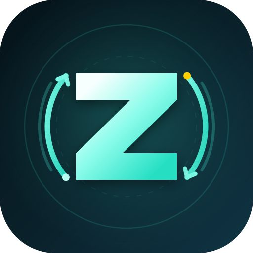

# Zync

<p align="center">
  
</p>

<p align="center">
  <strong>面向尼康 Z 系列的传输、无线互联与水印工坊。</strong>
</p>

<p align="center">
  <a href="README.md">English</a> |
  <a href="README.zh-CN.md">简体中文</a> |
  <a href="README.ja.md">日本語</a>
</p>

Zync 是一款使用 Flutter 开发的开源摄影工具，围绕尼康 Z 系列相机整理出一条紧凑的工作流：连接相机、浏览与传输照片，然后完成调色、水印和导出。应用可直接通过 Wi-Fi PTP/IP 或 USB PTP 与相机通信，不依赖厂商账号、云服务或专有 SDK。

- 项目地址：<https://github.com/sa1to-asuka/Zync>
- 当前版本：`2.6.0`
- 许可证：MIT
- 主要平台：Android

## 功能概览

| 模块 | 能力 |
| --- | --- |
| 相机连接 | Wi-Fi PTP/IP 与 USB OTG PTP |
| 相机浏览 | 浏览 JPG、NEF、NRW，并提取 RAW 内嵌预览 |
| 文件传输 | 分块下载、任务队列、暂停、取消、重试与自动回传 |
| 水印工坊 | 16 款模板、EXIF 参数、自定义文字、统一的预设调节面板与物理胶片模拟（20 款底片、红光晕、银盐颗粒） |
| 拍摄台 | 实时取景、遥控快门、曝光滑条、触控与手动对焦、间隔拍摄、峰值对焦、斑马纹与直方图 |
| 照片处理 | 调色预设、曝光与影调调整、裁剪、旋转、对比与拼图 |
| 自适应界面 | 手机底部导航与大屏左侧导航栏 |
| 应用更新 | GitHub Releases 检查与安装前 SHA-256 校验 |

## 连接方式

### Wi-Fi PTP/IP

手机先加入相机创建的无线热点，再从 Zync 建立连接。Wi-Fi 传输使用独立的 Command 与 Event TCP 通道，并支持配置端口、心跳间隔和会话保活，以降低相机在传输过程中休眠的概率。

### USB PTP

使用 USB OTG 数据线连接相机，并将相机设置为 PTP 模式。Zync 通过 Android USB Host API 建立标准 Still Image 会话，可浏览相机、接收事件和下载文件。USB 与 Wi-Fi 共用同一套传输队列和导出历史。

### 蓝牙 LSS

蓝牙低功耗 LSS 通道属于实验功能，入口默认隐藏，不是 Wi-Fi 或 USB 常规传输的必要条件。

## 主要功能

### 拍摄台（实时取景）

- 通过 Wi-Fi PTP/IP 或 USB PTP 拉取相机取景画面，并在手机上释放快门。
- 读取并写入曝光模式、光圈、快门速度、ISO 与曝光补偿。每次写入都会回读比对，相机静默忽略的修改会被如实报告，而不会假装成功。
- 点击取景画面移动对焦点，或按对焦按钮对画面中心对焦。
- 拍摄是否成功以相机对象列表中是否出现新 handle 为准，不以快门响应码为准。超时按「可能尚未完成」提示，绝不自动重试。
- 拍到的照片可通过现有「边拍边传」开关自动加入传输队列。
- 光圈、快门速度、ISO 与曝光补偿用滑条调节：拖动时只预览数值，松手才写相机。
- 只开放当前档位允许的参数。A 档下快门速度与 ISO 会置灰并给出说明，而不是静默失败。
- 峰值对焦、斑马纹、亮度直方图、构图网格与参考线都在本机根据取景画面计算，不影响导出的照片。
- 按住手动对焦箭头可以平滑推拉焦点，按 AF 按钮会执行一次真正的自动对焦。
- 间隔拍摄：设置间隔、张数与开始延时后自动连拍，照片同样走「边拍边传」。
- 机内 HDR：由相机拍两张合成一张 JPEG（`0xD130`–`0xD133`），可选择同时把两张原片留在卡上。
- 包围曝光 / 焦点包围拍完后，可选择在 App 内合成一张。原片始终留在相机存储卡，合成图是分享级分辨率，写入你指定的文件夹。
- 拍照 / 录像模式切换：在手机上启停录像，显示 REC 计时与双声道电平；直接在机身按红色录像键时，界面也会同步（取景帧头带录像标志）。
- 包围曝光：EV / 快门 / ISO 三轴任选，设置张数与步长；无论正常结束、中途停止还是相机拒绝写入，都会还原到拍摄前的参数。
- 焦点包围：按固定步长推进对焦马达并逐张拍摄，可设置拍完回到起点。
- 手机端取景是从主页网格进入的全屏工具，平板端是带侧栏的双栏工作台。实时取景与遥控拍摄已在尼康 Z 30 上验证，其他机型可能表现不同，界面会明确提示。

### 相机相册

- 浏览相机存储卡中的 JPG、NEF 与 NRW 文件。
- 无需完整解码 RAW 时，从 NEF/NRW 中提取内嵌 JPEG 预览。
- 单张下载或多选批量导出。
- 显示文件类型、大小和已导出状态，减少重复下载。
- 根据 EXIF 方向正确显示照片，支持双指缩放、双击缩放与下拉关闭。
- 在相机能力支持时删除本地或相机侧文件。
- 将多张照片合成为拼图。

### 传输引擎

- 通过 `GetPartialObject` 按 512 KB 分块流式下载。
- 下载队列写入磁盘，App 被杀或重连后从断点字节继续；相机端 ObjectHandle 按文件名、大小与拍摄时间重新匹配，匹配不到时明确提示而不是猜一个。
- 超过 4 GiB 的文件自动改用 `0x9431 GetPartialObject64`，长视频不会在 32 位偏移边界被截断。
- Wi-Fi 掉线或 USB 拔出时队列进入「等待重连」而不是判失败，重连成功后自动续传。
- 大图和 RAW 下载不会阻塞界面其他操作。
- 传输中心显示每条任务的进度与失败原因，支持暂停、继续、单条取消、失败重试和清理已完成任务。
- 后台传输使用前台服务与常驻进度通知，锁屏或切换应用后可继续执行。
- 监听 `ObjectAdded` 事件，可在拍摄后自动回传照片。
- 导出文件保存到 `/DCIM/Zync`，并记录导出历史。

### 水印工坊

- 提供 16 款画廊风格模板，包括高斯虚化边框、拍立得相纸、暗色玻璃、杂志字幕、胶片齿孔、渐变字幕和极简细线等样式。
- 可调整边框比例、强调色、卡片底色、圆角、透明度、字体与间距。
- 分别控制机型、镜头、曝光参数和拍摄日期的显示状态。
- 从 EXIF 自动读取机身、镜头、光圈、快门、ISO 与拍摄时间。
- 支持最多两行自定义文字。
- 提供 95、92、85 三档 JPEG 导出质量。
- 将尺寸、方向、机型、镜头、曝光、焦距与时间写回导出图片的 EXIF。
- 将「胶片滤镜」与「参数精调」合并为统一的**预设调节**面板：顶部预设流、可折叠分组滑块、预设切换 250ms 平滑过渡，并支持自建预设的保存、重命名、覆盖与删除。
- **胶片模拟**使用独立的原生 [spektrafilm](https://github.com/andreavolpato/spektrafilm) 光谱引擎移植：20 款真实底片、8 种印相纸、负片直扫，包含实测 H&D 密度曲线、DIR 抑制剂、红光晕、银盐颗粒与放大机滤色配光。

### 色彩优化工作室

- 通过 PTP/IP（`0x90CC` / `0x90CD`）读写机内自定义优化校准，写入 C1–C9 槽位并回读校验。
- 管理本地 NP3/NCP 配方库，支持从文件管理器、微信、QQ 导入，并可重命名、分享导出和删除。
- 支持单槽写入，或将多个配方批量分配到 C1–C9。
- 可将已有槽位设为相机当前优化校准（`0xD200`），或把机内槽位读回手机备份。
- 解析 Flexible Color（0310）配方，并可一键转换为标准 NP3 后写入。
- 使用内置场景样片预览配方，支持左右拖拽对比、257 点阶调曲线与完整参数调整。

### 视频编辑器

- 多段素材时间线，支持裁剪、排序、拼接与章节标记。
- 曝光、影调、色轮、关键帧调色，并支持 `.cube` LUT。
- 波形图、矢量示波器、RGB 分量与直方图监看。
- 导出 1080p 或 4K，H.264 / HEVC 编码；HDR 输入会映射为 SDR。

### 调色与图像编辑

- 按胶片风格组织色彩预设，并提供经典胶卷外观。
- 可微调曝光、对比度、高光、阴影、色温、色调、饱和度、锐化、暗角与颗粒。
- 调色结果可与水印模板组合导出。
- 保存前可对比编辑结果与原始照片。

### 自适应界面与返回逻辑

- 支持深色、浅色及跟随系统三种主题模式。
- 手机窄屏使用底部导航；窗口宽度达到 600 dp 后切换为左侧导航栏。
- 返回操作先关闭编辑器和弹窗，再退出多选等页面内部状态，然后回到「连接」页；首页连续两次返回才会退出应用。

## 使用流程

1. 开启尼康 Z 系列相机的 Wi-Fi，或使用 OTG 数据线连接相机。
2. 打开 **连接**，建立 Wi-Fi PTP/IP 或 USB PTP 会话。
3. 打开 **相机相册**，选择文件并加入传输队列。
4. 打开 **水印工坊**，应用模板、调色和自定义署名。
5. 将完成的 JPEG 导出到手机。

## 兼容性

- 面向尼康 Z 系列微单相机。
- Android 7.0（API 24）及以上。
- Wi-Fi 模式要求手机加入相机创建的无线热点。
- USB 模式要求手机支持 OTG，且相机提供标准 PTP Still Image 接口与 Bulk IN/OUT 端点。
- 实际表现可能随机型、固件、数据线和 Android USB 控制器而异，欢迎提交真机反馈。
- iOS 与桌面端尚未完整验证。

Zync 是独立开发的第三方项目，与尼康官方无关联，不使用尼康专有 SDK。「Nikon」「Z SERIES」等名称仅用于说明兼容范围，相关商标归各自权利人所有。

## 构建环境

- 支持 Dart 3.0 及以上的 Flutter SDK；项目声明最低 Flutter 版本为 3.10。
- Android compile SDK 36。
- JDK 17。
- 原生 RAW 处理模块使用 Android NDK `28.2.13676358`。

## 快速开始

```bash
git clone https://github.com/sa1to-asuka/Zync.git
cd Zync
flutter pub get
flutter run
```

## 构建应用

构建通用 Release APK：

```bash
flutter build apk --release
```

产物位置：

```text
build/app/outputs/flutter-apk/app-release.apk
```

构建仅含 ARM64 架构并分离调试符号的版本：

```bash
flutter build apk --release --split-per-abi --target-platform android-arm64 --split-debug-info=build/symbols/1.0.0-arm64
```

产物位置：

```text
build/app/outputs/flutter-apk/app-arm64-v8a-release.apk
```

请将调试符号与对应 APK 一同归档，以便后续解析崩溃堆栈。日常安装不要使用 Debug 包。

### Windows 构建路径

Flutter Release AOT 构建可能无法处理包含非 ASCII 字符的项目路径。如果 `gen_snapshot` 报错 `Unable to read file: ...app.dill`，请复制到纯 ASCII 路径后重新构建：

```powershell
robocopy . D:\zync_ascii /E /XD build .dart_tool .git
cd D:\zync_ascii
flutter build apk --release
```

### Release 签名

如果缺少 `android/key.properties`，构建会回退到 Debug 签名，仅适合本地调试。正式分发前请配置自己的 keystore：

```bash
keytool -genkey -v -keystore android/upload-keystore.jks -keyalg RSA -keysize 2048 -validity 10000 -alias upload
cp android/key.properties.example android/key.properties
```

然后在 `android/key.properties` 中填写密码和路径。该文件与 `*.jks` 均已加入 Git 忽略列表。

### 安装失败排查

发布两种 APK：`Zync-release-<ver>.apk`（arm64，推荐）和
`Zync-release-<ver>-armeabi-v7a.apk`（老旧 32 位设备）。在只支持 64 位的手机上
装 32 位包会因为「没有匹配的 ABI」直接失败。

如果 Android 拒绝安装：

1. 先卸载旧的 Zync。没有配置正式密钥库时构建会退回调试签名，而调试密钥属于
   打包的那台电脑——换一台电脑打的包无法覆盖安装。
2. 为你使用的浏览器或文件管理器打开「安装未知应用」权限。
3. 若提示签名冲突，说明已安装的副本是另一把密钥签的，只能先卸载。

`android/key.properties` 缺失时构建会退回调试签名，正式分发前请先配置密钥库。

### Release 资产与更新校验

Zync 从 <https://github.com/sa1to-asuka/Zync/releases> 检查更新。发布时请上传 APK 和同名 SHA-256 文件：

```text
Zync-release-1.0.0.apk
Zync-release-1.0.0.apk.sha256
```

校验文件内容格式：

```text
<sha256>  Zync-release-1.0.0.apk
```

应用内更新会在安装前校验文件完整性，校验失败时不会继续安装。

### 测试与静态检查

```bash
flutter test
flutter analyze
```

## 项目结构

```text
zync/
├── assets/icons/              应用图标资源
├── android/                   Android 宿主、USB PTP、BLE 与原生 RAW 模块
├── lib/
│   ├── core/                  常量、设置、主题与通用工具
│   ├── protocol/              PTP/IP、USB PTP 与相机驱动层
│   ├── engine/                传输、编辑、水印、视频与更新逻辑
│   └── ui/                    页面、组件与自适应导航
├── test/                      单元测试与组件测试
├── docs/                      协议说明与版本记录
└── pubspec.yaml
```

协议层、业务引擎与界面层保持分离。相机能力通过驱动接口暴露，便于后续增加新的传输方式或机型适配，而不影响界面层。

## 协议依据

Wi-Fi 与 USB 传输遵循公开的 Picture Transfer Protocol 模型：

- ISO 15740 / PIMA 15740：PTP 操作码、数据集、响应以及 USB Bulk-Only 容器。
- [gPhoto PTP/IP 文档](http://www.gphoto.org/doc/ptpip.php)：PTP/IP 包类型、握手行为与数据阶段布局。
- [Android USB Host API](https://developer.android.com/guide/topics/connectivity/usb/host)：USB 设备发现、接口、端点与批量传输。
- [libgphoto2](https://github.com/gphoto/libgphoto2)：公开的 PTP/IP 与尼康操作行为资料。

更多实现说明见 `docs/protocol-sources.md`。Zync 的协议实现不包含从第三方项目复制而来的源代码。

## 开源致谢

感谢以下项目的维护者与贡献者。各项目的版权与许可证归原作者所有。

### 核心项目与协议参考

| 项目 | 用途 | 许可证 |
| --- | --- | --- |
| [ImageToolbox](https://github.com/T8RIN/ImageToolbox) | 图像处理、滤镜与编辑交互参考 | Apache-2.0 |
| [Recipe Lab](https://github.com/voxivoid/recipe-lab-sony-pmca) | 色彩配方与胶片外观数据结构参考 | GPL-3.0 |
| [Spektrafilm](https://github.com/andreavolpato/spektrafilm) | 独立原生光谱胶片引擎：H&D 密度曲线、DIR 抑制剂、红光晕、银盐颗粒与印相纸冲印 | 代码 GPL-3.0 / 档案 CC BY-SA 4.0 |
| [NICO](https://github.com/haecksenwerk/nico) | USB 实时取景、对焦点选择与曝光属性读写参考 | MIT |
| [OpenCine](https://github.com/erik-sutton95/OpenCine) | Z 系列能力分级、PTP/IP `0x000D` 探活、`0x9431` 分块与取景帧头遥测解析参考 | Apache-2.0 |
| [OpenZCine](https://github.com/erik-sutton95/OpenZCine) | 断线重连状态机：单次超时、总恢复预算、退避与重连风暴防抖参考 | Apache-2.0 |
| [digiCamControl](https://github.com/dukus/digiCamControl) | 包围曝光序列生成、参数还原与 A-B 点焦点堆叠交互参考 | MIT |
| [airnef](https://github.com/besi/airnef) | 断点续传状态校验思路参考，未复用其源代码 | GPL-3.0 |
| [Shotdeck](https://github.com/Fluoro-Antimonic-Acid/Shotdeck) | 实时取景、拍摄与对象落盘确认行为参考 | GPL-3.0 |
| [LutCameraPro](https://github.com/laodamanbaout/LutCameraPro-) | PTP/IP 取景与连接边界参考 | Apache-2.0 |
| [1dlut-z30-filters](https://github.com/haotiandi1011-lgtm/1dlut-z30-filters) | Z 30 影调曲线负载结构与 C1–C9 回读校验参考 | MIT |
| [aero-shutter](https://github.com/subhashraveendran/aero-shutter) | Wi-Fi PTP/IP 导入行为参考 | MIT |
| [NikonCameraControl](https://github.com/youdangshi/NikonCameraControl) | Android 遥控与传输流程参考 | MIT |
| [SnapBridge-Enhanced](https://github.com/MXWF0/SnapBridge-Enhanced) | 尼康连接流程与交互参考 | 仓库当前未声明许可证 |
| [nsg](https://github.com/hurui200320/nsg) | 尼康协议与设备能力参考 | AGPL-3.0 |
| [libgphoto2](https://github.com/gphoto/libgphoto2) | PTP/IP 与尼康操作码参考 | LGPL-2.1 |
| [ptplibrary](https://github.com/laheller/ptplibrary) | PTP/IP 与 USB PTP 行为参考 | 仓库当前未声明许可证 |
| [ptpip](https://github.com/mmattes/ptpip) | PTP/IP 实现参考 | Apache-2.0 |
| [libptp](https://github.com/Fimagena/libptp) | PTP/IP 与 USB PTP 实现参考 | LGPL-2.1 |
| [NikonCopy](https://github.com/Zephyrion-Yuan/NikonCopy) | Android USB OTG PTP 文件访问参考 | 仓库当前未声明许可证 |
| [furble](https://github.com/gkoh/furble) | 尼康 BLE 快门行为参考 | MIT |
| [nikongeotag](https://github.com/rjmendez/nikongeotag) | 尼康 BLE smart-device 协议参考 | GPL-3.0 |

### 色彩优化配方与预览素材

| 项目 | 用途 | 许可证 |
| --- | --- | --- |
| [Z30-Recipes](https://github.com/yekong-nasa/Z30-Recipes) | 尼康 Z30 PTP/IP（0x90CC/0x90CD/0xD200）机内优化校准读写与 NP3/NCP 解析参考 | MIT |
| [NikonNP3](https://github.com/Timor88/NikonNP3) | 尼康 NP3 创意色彩配方合集与分类标签参考 | 社区共享 |
| [nikon-flexible-color-picture-control](https://github.com/ssssota/nikon-flexible-color-picture-control) | 尼康 Flexible Color NP3（0310）二进制偏移与色彩混合器结构解析参考 | MIT |
| [Nikon Imaging（ニコンイメージング）](https://www.nikon-image.com/) | 色彩优化近似效果预览官方样片素材（Z 30 / Z fc / Z f / Z 8 实拍样片） | Nikon 官方样片展示许可 |
| [Pakutaso（ぱくたそ）](https://www.pakutaso.com/) | 色彩优化近似效果预览免费人像与生活样片素材备选参考 | Pakutaso 免费素材许可 |
| [影视飓风（YSJF）](https://www.ysjf.com/index) | 色彩优化近似效果预览风光与自然样片素材致谢 | 免费样片素材许可 |

### 运行时与基础依赖

| 项目 | 用途 | 许可证 |
| --- | --- | --- |
| [Flutter](https://github.com/flutter/flutter) | 跨平台 UI 与运行时 | BSD-3-Clause |
| [Dart SDK](https://github.com/dart-lang/sdk) | Dart 语言与运行时 | BSD-3-Clause |
| [LibRaw](https://github.com/LibRaw/LibRaw) | 相机 RAW 解码 | LGPL-2.1 / CDDL-1.0 |
| [AndroidX Media3](https://github.com/androidx/media) | 视频播放、抽帧与编辑 | Apache-2.0 |
| [Kotlin](https://github.com/JetBrains/kotlin) | Android 原生语言与运行时 | Apache-2.0 |
| [flutter_svg](https://github.com/dnfield/flutter_svg) | SVG 渲染 | MIT |
| [image](https://github.com/brendan-duncan/image) | 图像编码与处理 | MIT |
| [exif](https://github.com/bigflood/dartexif) | EXIF 元数据读写 | MIT |
| [crypto](https://github.com/dart-lang/crypto) | SHA-256 与摘要算法 | BSD-3-Clause |
| [intl](https://github.com/dart-lang/i18n) | 国际化与日期格式 | BSD-3-Clause |
| [path_provider](https://github.com/flutter/packages/tree/main/packages/path_provider) | 平台目录定位 | BSD-3-Clause |
| [video_player](https://github.com/flutter/packages/tree/main/packages/video_player) | 视频播放支持 | BSD-3-Clause |

应用内也可通过 **设置 → 关于 Zync → 项目与许可 → 开源致谢** 查看同一份致谢数据。当前未声明许可证的项目会如实标注，不会被描述为已开源许可。

## 贡献者

- [sa1to-asuka](https://github.com/sa1to-asuka) — 作者与维护者
- Claude（Anthropic）— 协助实现、测试与文档的 AI 结对编程助手

## 开源许可

Zync 使用 [MIT License](LICENSE) 开源。欢迎在 <https://github.com/sa1to-asuka/Zync> 提交 Issue 或 Pull Request。
